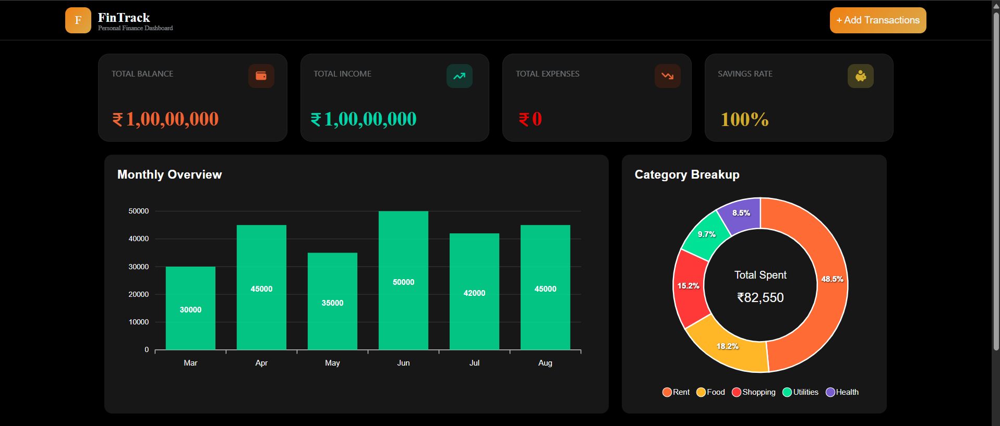
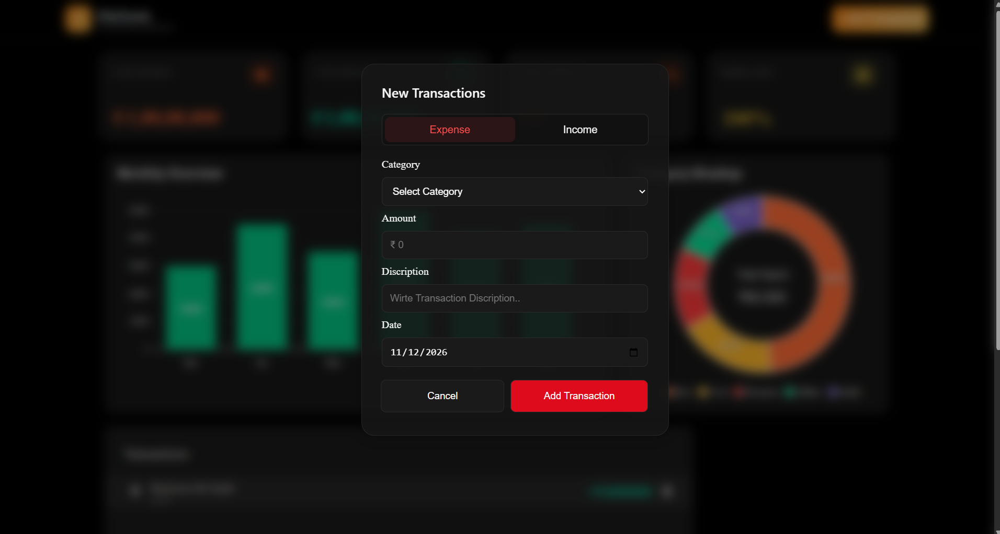
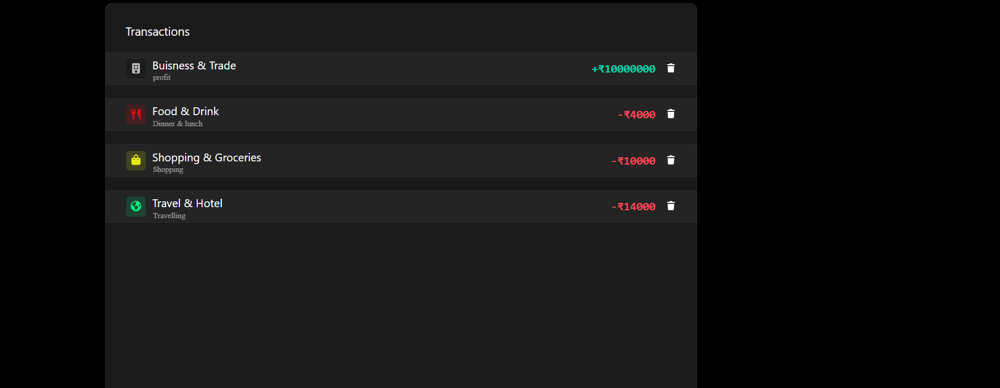

# FinTrack – Expense Tracker

FinTrack is a personal finance tracker built with React. It helps users keep track of their income and expenses through a simple dashboard.

I built this project to practise React development, state management, and working with browser LocalStorage.

## Features

- **Add Transactions:** Add income and expense transactions with an amount, category, description, and date.
- **Transaction Categories:** Choose different categories for income and expenses.
- **Financial Summary:** View total balance, total income, and total expenses.
- **Savings Rate:** Calculate the savings rate based on income and expenses.
- **Delete Transactions:** Remove transactions from the dashboard.
- **LocalStorage:** Save transactions in the browser so they remain available after refreshing the page.
- **Dashboard Charts:** Includes monthly overview and category breakup visualizations.

## Tech Stack

- **Frontend:** React.js, JavaScript, CSS
- **Charts:** ApexCharts, React ApexCharts
- **Icons:** Font Awesome
- **Storage:** Browser LocalStorage
- **Build Tool:** Vite

## Screenshots

### Dashboard



### Add Transaction



### Transactions



## Project Structure

```text
expense-tracker/
│
├── public/
├── src/
│   ├── assets/
│   ├── components/
│   │   ├── header.jsx
│   │   ├── Main.jsx
│   │   └── dashboardcharts.jsx
│   │
│   ├── style/
│   ├── App.jsx
│   ├── App.css
│   ├── index.css
│   └── main.jsx
│
├── index.html
├── package.json
├── package-lock.json
├── vite.config.js
├── .gitignore
└── README.md
```

## Getting Started

Follow these steps to run the project locally.

### Prerequisites

- Node.js
- npm

### 1. Clone the repository

```bash
git clone https://github.com/PrateekTailor/expense-tracker.git
```

### 2. Navigate to the project directory

```bash
cd expense-tracker
```

### 3. Install dependencies

```bash
npm install
```

### 4. Start the development server

```bash
npm run dev
```

Open the local URL displayed in the terminal to use the application.

### 5. Create a production build

```bash
npm run build
```

The production files will be generated inside the `dist` folder.

## Data Storage

Transaction data is stored in the browser using LocalStorage.

This means the saved transactions remain available in the same browser, even after refreshing the page. The data is not synchronized across different devices.

## Future Improvements

- Connect dashboard charts with actual transaction data.
- Add an option to edit existing transactions.
- Improve dashboard responsiveness.
- Add backend integration and user authentication.

## Author

**Prateek Tailor**